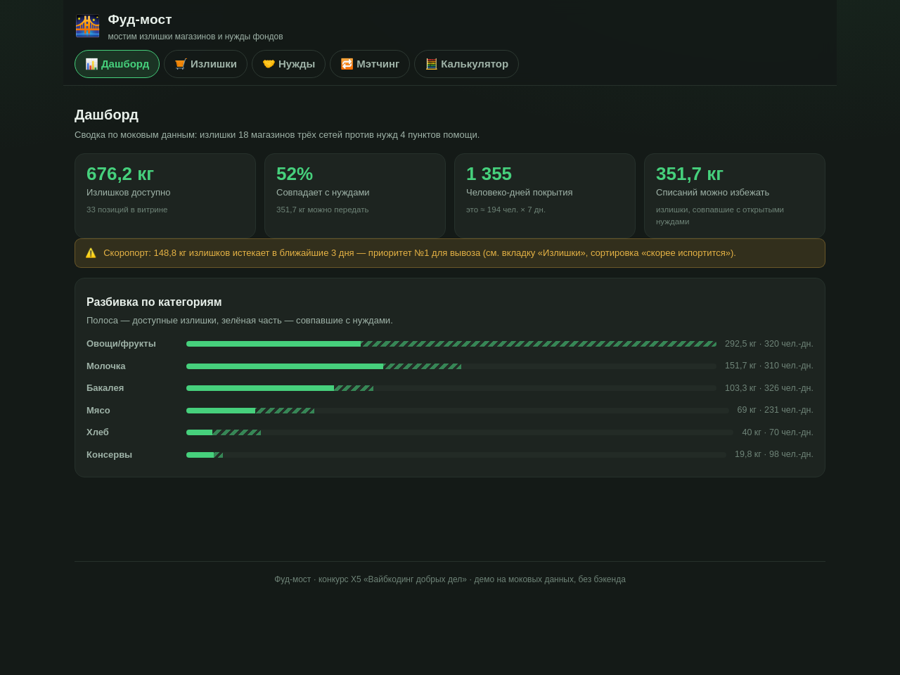
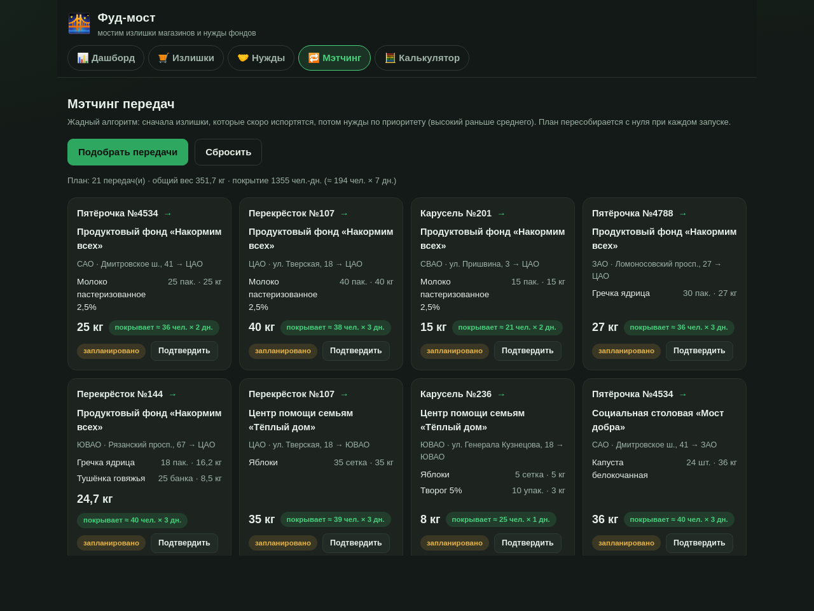
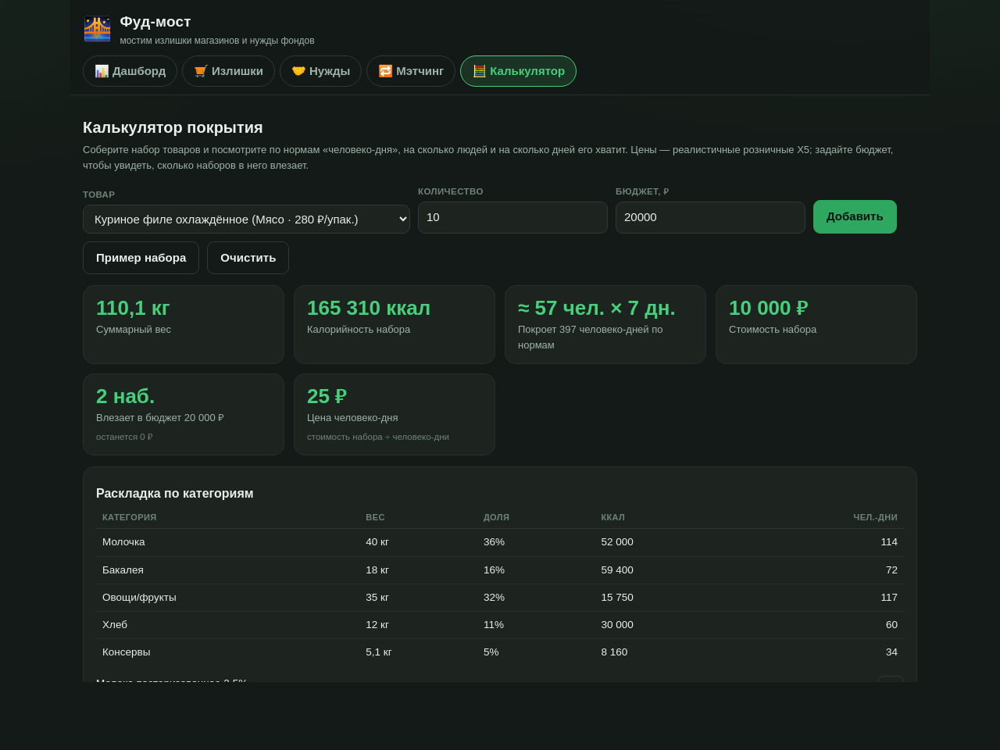

# 🌉 Фуд-мост

Конкурсная работа X5 «Вайбкодинг добрых дел».
Направления: сокращение пищевых отходов в ритейле + помощь благополучателям
продуктового фонда.

**Фуд-мост** — одностраничное веб-приложение без бэкенда: витрина продуктовых
излишков магазинов, витрина нужд пунктов помощи, автоматический мэтчинг передач
и калькулятор покрытия — на сколько человек и на сколько дней хватит передачи.

## Демо

Живая страница: **https://omsoft-tech.github.io/food-bridge/** — GitHub Actions
деплоит ветку `main` автоматически. Deep-ссылки открывают приложение в готовом
состоянии: `?tab=…` — вкладка, `&run=demo` — сразу построить план передач
или подставить пример набора.

### Дашборд — сводка, разбивка по категориям, скоропорт



→ [Открыть дашборд](https://omsoft-tech.github.io/food-bridge/?tab=dashboard)

### Мэтчинг — план передач, построенный при открытии ссылки



→ [Открыть с автоподбором передач](https://omsoft-tech.github.io/food-bridge/?tab=matching&run=demo)

### Калькулятор — пример набора в бюджете 20 000 ₽



→ [Открыть с примером набора](https://omsoft-tech.github.io/food-bridge/?tab=calc&run=demo)

## Польза

**Для ритейла.** Излишки — это замороженные деньги и платное вывоз-утилизация.
Приложение показывает, сколько килограммов на витрине совпадает с реальными
нуждами фондов: эти килограммы превращаются из статьи расходов (списание)
в социальный эффект и ESG-метрику «избегнутых списаний».

**Для фондов и благополучателей.** Пункты помощи видят витрину излишков и свои
открытые нужды, а мэтчинг по приоритетам собирает план передач: что, откуда и
в какой пункт везти, и на сколько человеко-дней хватит каждой передачи.

## Как запустить

```bash
npm install    # зависимости
npm run dev    # дев-сервер http://localhost:5173
npm run build  # прод-сборка в dist/ (tsc + vite build)
npm run preview # локальный просмотр прод-сборки
```

Работает полностью на статике: все данные — моки в `src/data/`, все
интеракции — локально в браузере. Деплой на GitHub Pages — через GitHub
Actions (`.github/workflows/deploy.yml`), публикуется ветка `main`.

## Экраны (5 вкладок)

1. **Дашборд** — сводка: доступные излишки (кг), доля совпадения с нуждами (%),
   человеко-дни покрытия, избегнутые списания; разбивка по категориям и плашка
   скоропорта.
2. **Излишки** — витрина излишков с фильтрами по категории, сети и сроку
   годности; сортировка «скорее испортится» сверху.
3. **Нужды** — карточки пунктов помощи с прогрессом закрытия потребности
   (получено + уходит в текущий план).
4. **Мэтчинг** — «Подобрать передачи»: жадный алгоритм сортирует излишки по
   сроку годности и закрывает нужды по приоритету; план передач магазин → пункт
   (состав, кг, покрывает N чел × M дней), статусы «запланировано /
   подтверждено», кнопка «Сбросить».
5. **Калькулятор** — условный набор товаров: суммарный вес, калорийность,
   «покроет X человек на Y дней» по нормам и раскладка по категориям; стоимость
   набора по реалистичным ценам X5, а при заданном бюджете — сколько наборов
   в него влезает и цена одного человеко-дня.

## Стек

- React 18 + Vite + TypeScript (strict)
- обычный CSS с переменными, без UI-библиотек
- данные — статические JSON-моки (`src/data/`)
- роутинг на query-параметрах без зависимостей (`?tab=surpluses`,
  `?tab=matching&run=demo`) — вкладка и демо-состояния шарятся ссылкой
- деплой — GitHub Pages + GitHub Actions

## Структура

```
src/
├── data/          # моки: товары, магазины (3 сети × 6), излишки, нужды, пункты (4)
├── lib/
│   ├── nutrition.ts   # нормы «человеко-дня» и ккал/кг по категориям
│   ├── stats.ts       # сводка дашборда
│   ├── matching.ts    # жадный алгоритм мэтчинга
│   └── format.ts      # форматирование (ru-RU, даты, покрытие)
├── components/    # 5 экранов + общие UI-компоненты
└── types.ts       # типы предметной области
```

## Допущения MVP

- Данные моковые и «вечнозелёные»: срок годности излишков хранится как
  «дней до истечения», дата считается от текущего дня, чтобы демо не старело.
- Нормы «человеко-дня» условные (≈1,4 кг/чел·день, по 6 категориям) — для
  продукта их задаёт нутрициолог фонда.
- «Покроет X человек на Y дней» — грубая интерпретация человеко-дней с выбором
  горизонта 1/2/3/7 дней; в реальном продукте горизонт задаёт пункт помощи.
- Цены товаров в моках — реалистичные розничные X5 (руб/ед. + руб/кг,
  поле `price` / `pricePerKg`); бюджет в калькуляторе — ввод пользователя,
  расчёты индикативные.

## Явно не входит в MVP

Регистрация/авторизация, реальные API, карты, push-уведомления, i18n кроме
русского.

## Лицензия

[MIT](LICENSE)
